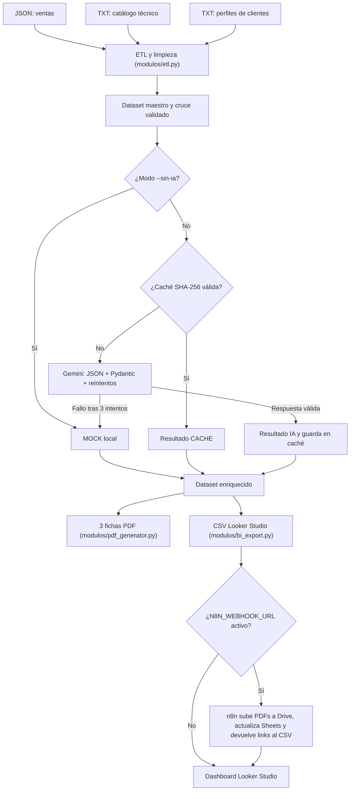

# TALSA | Transformación Digital: análisis técnico de ventas con IA

> **Proyecto personal de transformación digital: análisis técnico de ventas con IA**  
> Python · pandas · Google Gemini · Pydantic · fpdf2 · n8n · Looker Studio

Este proyecto transforma **tres fuentes comerciales y técnicas sin claves comunes** en informes de compatibilidad para cada venta, fichas PDF con identidad visual TALSA y un CSV preparado para analizar en Looker Studio, con publicación opcional automatizada mediante **n8n** hacia Google Drive y Google Sheets.

**En pocas palabras:** se lee lo que se vendió, se identifica la ficha del equipo, se recuperan las necesidades del cliente, se solicita o reutiliza un análisis técnico estructurado y se publican los resultados como archivos locales y/o en la nube.

> [!IMPORTANT]
> Los datos de demostración son **ficticios**. El catálogo indica expresamente que algunas especificaciones están pendientes de validación con fábrica. Los resultados de IA, caché o simulación son **orientativos**, no sustituyen la validación de ingeniería, requisitos legales, manuales oficiales ni procedimientos de seguridad industrial.

## Índice

1. [Objetivo y alcance](#1-objetivo-y-alcance)
2. [Resultados y estado actual](#2-resultados-y-estado-actual)
3. [Tecnologías y requisitos previos](#3-tecnologías-y-requisitos-previos)
4. [Estructura del repositorio](#4-estructura-del-repositorio)
5. [Instalación desde cero](#5-instalación-desde-cero)
6. [Cómo ejecutar el pipeline](#6-cómo-ejecutar-el-pipeline)
7. [Flujo de datos y arquitectura](#7-flujo-de-datos-y-arquitectura)
8. [Cómo se cruzan datos sin claves foráneas](#8-cómo-se-cruzan-datos-sin-claves-foráneas)
9. [Cómo funciona el análisis con IA](#9-cómo-funciona-el-análisis-con-ia)
10. [Validaciones, reintentos y caché](#10-validaciones-reintentos-y-caché)
11. [Fichas PDF y manual de marca](#11-fichas-pdf-y-manual-de-marca)
12. [Dataset, automatización con n8n y dashboard de Looker Studio](#12-dataset-automatización-con-n8n-y-dashboard-de-looker-studio)
13. [Pruebas y verificación](#13-pruebas-y-verificación)
14. [Seguridad, límites y mejoras](#14-seguridad-límites-y-mejoras)
15. [Problemas frecuentes](#15-problemas-frecuentes)
16. [Información del proyecto](#16-información-del-proyecto)

## 1. Objetivo y alcance

El problema de negocio es que las ventas (`JSON`), las especificaciones técnicas (`TXT`) y las notas de visita de clientes (`TXT`) están separadas. Preparar una ficha adaptada a cada cliente requiere consultar manualmente distintas fuentes.

El pipeline automatiza cinco tareas:

1. **Ingesta y limpieza:** leer con Python y pandas; estandarizar textos, fechas y montos.
2. **Cruce:** asociar cada venta con su modelo de equipo y su perfil de cliente **sin claves compartidas de origen**.
3. **Enriquecimiento:** producir especificaciones, casos de uso, recomendaciones, compatibilidad (0–100) y complejidad (`Alto`, `Medio`, `Bajo`) con Gemini o, en modo local, con ejemplos simulados (`MOCK`).
4. **Documentación:** generar **un PDF por venta**, tabulado y con los colores y el logotipo de TALSA.
5. **BI y Automatización:** construir un dataset de **una fila por venta** para métricas, gráficos y filtros de Looker Studio, y sincronizar opcionalmente los PDFs y registros mediante un Webhook de **n8n** con Google Drive y Google Sheets.

Los tres equipos incluidos en los datos de demostración son **PX-3000** (pasteurizador), **CV-150** (caldera) y **LF-50** (liofilizador).

## 2. Resultados y estado actual

En `salida/` se incluyen los archivos generados por el pipeline:

| Archivo | Para qué sirve |
|---|---|
| `ficha_V-2026-0101.pdf` | Ficha de la venta del pasteurizador PX-3000. |
| `ficha_V-2026-0102.pdf` | Ficha de la venta de la caldera CV-150. |
| `ficha_V-2026-0103.pdf` | Ficha de la venta del liofilizador LF-50. |
| `dataset_looker_studio.csv` | Datos resumidos y tipados (19 columnas) para el tablero de Looker Studio. |
| `cache_ia.json` | Respuestas reutilizables cuya validez depende del hash SHA-256 de los insumos. |

**Estado actual del proyecto:** 3 ventas, 3 PDFs de una página, 3 filas y 19 columnas en el CSV de Looker Studio; **7 pruebas de `pytest` aprobadas** (incluyendo el flujo completo e integración con n8n). La ejecución local sin IA también se verificó de extremo a extremo.

**Estado del dashboard:** el código y el CSV están preparados para Looker Studio. El tablero interactivo publicado se encuentra disponible en: [Dashboard TALSA en Looker Studio](https://datastudio.google.com/reporting/4778f074-a166-4442-ae63-384c8d901691).

## 3. Tecnologías y requisitos previos

| Tecnología | Función |
|---|---|
| Python (recomendado 3.11 o superior) | Ejecución y organización del proceso. |
| `pandas` | Lectura, transformación, cruce y exportación tabular. |
| `google-genai` | Cliente oficial para Google Gemini. |
| `pydantic` | Validación de la estructura JSON devuelta por IA. |
| `fpdf2` | Diseño y creación de fichas PDF corporativas. |
| `python-dotenv` | Lectura local de variables de entorno desde `.env`. |
| `pytest` | Pruebas automatizadas unitarias y de integración. |
| `n8n` (opcional) | Orquestación para subir PDFs a Google Drive y actualizar Google Sheets. |
| Looker Studio | Visualización del dataset BI. |

Necesitas **Python** instalado, acceso a una terminal y, **solo para ejecutar Gemini en vivo**, conexión a Internet y una clave válida de Google AI Studio. No se requiere base de datos. No uses el entorno virtual de otra persona; créalo en tu computadora.

## 4. Estructura del repositorio

```text
talsa-transformacion-digital/
├── datos/
│   ├── clientes_ventas.json           # Datos comerciales de origen
│   ├── catalogo_equipos_raw.txt       # Fichas técnicas desordenadas
│   └── perfil_cliente_contexto.txt    # Necesidades operativas de clientes
├── modulos/
│   ├── etl.py                         # Extracción, limpieza, cruces y controles
│   ├── ia_cache.py                    # Prompt, Gemini, esquemas Pydantic, reintentos y caché
│   ├── pdf_generator.py               # Renderizado de fichas corporativas PDF
│   ├── bi_export.py                   # Dataset para BI, resolución de enlaces y notificación n8n
│   └── __init__.py
├── n8n/
│   └── workflow_drive_sheets.json     # Flujo importable en n8n (Webhook -> Drive -> Sheets)
├── recursos/
│   └── talsa-logo.png                 # Logo utilizado en los PDF
├── salida/
│   ├── ficha_V-2026-0101.pdf
│   ├── ficha_V-2026-0102.pdf
│   ├── ficha_V-2026-0103.pdf
│   ├── dataset_looker_studio.csv
│   └── cache_ia.json
├── tests/
│   └── test_pipeline_ia.py            # Suite de pruebas automatizadas (7 tests)
├── .env.example                       # Ejemplo de configuración sin claves reales
├── .gitignore                         # Exclusión de secretos y archivos locales
├── pipeline_ia.py                     # Único punto de entrada (CLI)
├── pytest.ini
├── requirements.txt
└── README.md
```

> `.env`, `.venv/`, `.git/`, las cachés de Python y los archivos temporales **no deben subirse ni incluirse en un archivo comprimido**. `.env.example` sí debe incluirse.

## 5. Instalación desde cero

Abre una terminal **dentro de la carpeta raíz del proyecto**, donde se encuentra `pipeline_ia.py`.

### Windows PowerShell

```powershell
# 1. Comprobar Python
python --version

# 2. Crear y activar entorno virtual aislado
python -m venv .venv
.\.venv\Scripts\Activate.ps1

# 3. Instalar dependencias
python -m pip install -r requirements.txt

# 4. Crear archivo de configuración local (NO subirlo a Git)
Copy-Item .env.example .env
```

Si PowerShell restringe la activación, se puede usar directamente `.\.venv\Scripts\python.exe pipeline_ia.py --sin-ia`, sin activar el entorno.

### macOS o Linux

```bash
python3 --version
python3 -m venv .venv
source .venv/bin/activate
python -m pip install -r requirements.txt
cp .env.example .env
```

**Configurar IA y enlaces (opcional):** edita `.env` e introduce tu clave real o las variables opcionales de publicación, sin compartirlas:

```dotenv
GEMINI_API_KEY="REEMPLAZAR_POR_MI_CLAVE_PRIVADA"
# N8N_WEBHOOK_URL="http://localhost:5678/webhook/talsa-bi"
# TALSA_PDF_BASE_URL="https://raw.githubusercontent.com/tu-usuario/talsa-transformacion-digital/main/salida"
# TALSA_PDF_LINKS_MAP='{"V-2026-0101":"https://drive.google.com/...","V-2026-0102":"https://drive.google.com/...","V-2026-0103":"https://drive.google.com/..."}'
```

La API puede estar sujeta a disponibilidad, límites y costos del proveedor. Si solo quieres reproducir el flujo sin conectarte, **no hace falta una clave**: ejecuta `--sin-ia`.

## 6. Cómo ejecutar el pipeline

| Comando | Qué ocurre |
|---|---|
| `python pipeline_ia.py --sin-ia` | Ejecuta todo con resultados simulados (`MOCK`), sin llamar a Gemini. Es la primera prueba recomendada. |
| `python pipeline_ia.py` | Intenta usar caché válida o consultar Gemini (`gemini-flash-lite-latest` por defecto); si falla, usa un resultado `MOCK` y lo advierte. |
| `python pipeline_ia.py --modelo gemini-2.5-flash` | Solicita otro modelo de Gemini; verifica previamente que exista y esté habilitado en tu cuenta. |
| `python pipeline_ia.py --help` | Lista los argumentos disponibles y sus valores predeterminados. |

Para una demostración controlada, empieza con:

```powershell
python pipeline_ia.py --sin-ia
```

Revisa la salida en consola y abre la carpeta `salida/`. Tanto los PDF como el CSV registran en `origen_analisis` si el análisis provino de `IA`, `CACHE` o `MOCK`.

**Para mostrar una petición nueva a Gemini:** configura `GEMINI_API_KEY` en `.env`, respalda `salida/cache_ia.json`, elimina esa caché de tu copia local (o modifica deliberadamente los insumos/modelo) y ejecuta `python pipeline_ia.py`. Comprueba en consola `[OK] [...] Análisis IA validado con éxito`. Si ves `[CACHE]`, se reutilizó una respuesta previa; si ves `[MOCK]`, no hubo respuesta válida de Gemini.

## 7. Flujo de datos y arquitectura



La **orquestación** está en `pipeline_ia.py`. Los módulos en `modulos/` encapsulan responsabilidades específicas (`etl.py`, `ia_cache.py`, `pdf_generator.py` y `bi_export.py`) y se comunican mediante `DataFrame` y esquemas Pydantic. Esto facilita mantener y probar cada etapa de forma modular.

## 8. Cómo se cruzan datos sin claves foráneas

### Venta + equipo: clave canónica de modelo por Regex

El nombre comercial en ventas y la ficha técnica en el catálogo contienen el identificador alfanumérico del modelo, pero escrito de maneras distintas:

| Fuente comercial (`clientes_ventas.json`) | Fuente técnica (`catalogo_equipos_raw.txt`) | Clave canónica (`codigo_modelo`) |
|---|---|---|
| `Pasteurizador de placas PX-3000` | `px3000` | `PX3000` |
| `Caldera pirotubular CV-150` | `CV150` | `CV150` |
| `Liofilizador industrial LF-50` | `LF 50` | `LF50` |

`extraer_codigo_modelo()` utiliza la expresión regular `\b([A-Za-z]{2})[\s\-]*(\d{2,4})\b` que reconoce **dos letras y de dos a cuatro números**, admite espacios o guiones intermedios y devuelve un código estándar en mayúsculas. Luego se realiza un `LEFT JOIN` (`pd.merge`) por `codigo_modelo` y se **rechazan ventas sin ficha técnica asociada**.

### Venta + cliente: nombre de empresa normalizado

`cargar_perfiles_clientes()` separa las notas comerciales por párrafos; cada bloque comienza con la razón social seguida por una raya (`—`). Se genera la clave `empresa_norm` aplicando `.strip().lower()` en ambas fuentes. El sistema hace un `LEFT JOIN` por `empresa_norm` y **rechaza ventas sin perfil de cliente asociado**.

**¿Por qué no usar `id_cliente`?** Porque ese identificador está en el JSON de ventas, pero no en el archivo de texto de perfiles. Normalizar el nombre de la empresa presente en ambas fuentes permite relacionarlas de forma determinista.

### Otras transformaciones y controles en `modulos/etl.py`

- `pd.json_normalize()` aplana `ubicacion.ciudad`, `ubicacion.departamento` y `ubicacion.pais` en columnas de primer nivel.
- Se extrae `tipo_equipo` tomando la primera palabra del equipo comprado capitalizada (`Pasteurizador`, `Caldera`, `Liofilizador`).
- Las fechas se estandarizan al formato `YYYY-MM-DD`; los montos se convierten a numéricos redondeados a dos decimales.
- Se valida integridad: se rechazan `id_venta` duplicados, montos nulos, cero o negativos, y cualquier venta que quede sin ficha técnica o sin perfil tras el cruce.

**Limitación:** el emparejamiento por nombre puede fallar ante variaciones de tildes, cambios de razón social o errores tipográficos. El método actual es óptimo para estas tres entradas controladas; en un entorno productivo convendría un maestro de clientes con IDs unificados.

## 9. Cómo funciona el análisis con IA

### Datos enviados y diseño del prompt

`construir_prompt()` en `modulos/ia_cache.py` ensambla una instrucción clara con el rol de ingeniero experto de TALSA, la regla estricta de basarse únicamente en los datos suministrados sin inventar especificaciones, los datos del cliente y su perfil operativo en planta, y la ficha técnica cruda del equipo comprado.

### Salida JSON estructurada con Pydantic

Gemini se invoca con `response_mime_type="application/json"`, `response_schema=AnalisisTecnicoIA` y `temperature=0.1`. Un ejemplo de la estructura validada es:

```json
{
  "especificaciones_tabla": [
    {"parametro": "Capacidad nominal", "valor": "3.000 L/h (leche) / 2.000 L/h (viscosos)"},
    {"parametro": "Temperatura HTST", "valor": "72 a 85 °C (retención 15 s)"},
    {"parametro": "Salida producto enfriado", "valor": "4 °C +/- 1 °C (pide agua a 2 °C)"},
    {"parametro": "Regeneración térmica", "valor": "90% aprox."}
  ],
  "casos_uso": [
    "Pasar de pasteurización por lotes (63 °C/30 min) a proceso continuo HTST",
    "Pasteurización de leche en bolsa y bases de yogur/kumis ahorrando energía"
  ],
  "recomendaciones": [
    {"parametro": "Agua helada", "valor_unidad": "2 °C", "motivo": "Ampliar banco de hielo porque el agua llega caliente en temporada seca"},
    {"parametro": "Retención HTST", "valor_unidad": "72-85 °C por 15 s", "motivo": "Cumplir norma INVIMA mediante control PLC"},
    {"parametro": "Caudal en viscosos", "valor_unidad": "2.000 L/h máx.", "motivo": "Bajar caudal en mezclas viscosas cuidando no superar 6 bar"}
  ],
  "score_compatibilidad": 84,
  "justificacion_score": "Excelente ajuste en capacidad, ahorro energético y norma INVIMA; requiere mejorar el banco de hielo.",
  "complejidad_tecnica": "Medio"
}
```

El esquema Pydantic `AnalisisTecnicoIA` exige:
- **`especificaciones_tabla`**: entre **4 y 7** especificaciones (`EspecificacionEquipo`).
- **`casos_uso`**: entre **2 y 4** casos de uso aplicables a la planta.
- **`recomendaciones`**: entre **3 y 5** recomendaciones operativas (`RecomendacionOperativa`).
- **`score_compatibilidad`**: entero entre **0 y 100**.
- **`complejidad_tecnica`**: literal estricto `'Alto'`, `'Medio'` o `'Bajo'`.

> El score **lo estima el modelo**, no es una fórmula ingenieril certificada ni una probabilidad. La complejidad también es una categoría de evaluación asistida por IA.

## 10. Validaciones, reintentos y caché

### Respuestas inválidas y fallos de API

`analizar_venta()` intenta la llamada a Gemini hasta **3 veces** (`max_reintentos = 3`) con un timeout de 40 segundos por petición, y valida tanto la sintaxis JSON como las restricciones de `AnalisisTecnicoIA.model_validate_json()` **dentro del bloque `try`**. Si ocurre un error de red/API (`503`, `429`, timeout) o si el modelo devuelve un JSON que no cumple el esquema Pydantic, espera de forma incremental (`2 * intento` segundos) y reintenta. Si fallan los 3 intentos, el sistema activa automáticamente el respaldo **MOCK** sin interrumpir el pipeline.

### Trazabilidad del origen (`origen_analisis`)

| Valor | Significado | ¿Se consulta Gemini en esta ejecución? |
|---|---|---|
| `IA` | Respuesta nueva generada y validada por Gemini. | Sí. |
| `CACHE` | Respuesta previa validada asociada al mismo hash de insumos. | No (0 llamadas a la API). |
| `MOCK` | Respaldo local predefinido (`--sin-ia`, sin `GEMINI_API_KEY` o tras agotar reintentos). | No, o la consulta falló. |

### Cómo evita repetir consultas

`generar_hash_consulta()` calcula un hash SHA-256 (recortado a 16 caracteres) a partir de `id_venta|modelo|ficha|perfil`. La entrada guardada en `salida/cache_ia.json` se reutiliza únicamente si el hash coincide y los datos pasan la validación de `AnalisisTecnicoIA`. Si cambia cualquier insumo o el nombre del modelo, el hash cambia y se realiza una nueva consulta a la IA. Las respuestas `MOCK` **nunca se guardan en `cache_ia.json`**, evitando contaminar la caché con datos simulados.

## 11. Fichas PDF y manual de marca

`modulos/pdf_generator.py` usa `fpdf2` (`FichaTalsaPDF`), tamaño A4, márgenes limpios y tablas estructuradas con datos comerciales, especificaciones técnicas, casos de uso y recomendaciones operativas. Genera un archivo `ficha_<id_venta>.pdf` por cada venta.

Se aplican las reglas del **Manual de Marca TALSA**:

| Elemento | Aplicación |
|---|---|
| Logotipo | Arriba a la izquierda (`recursos/talsa-logo.png`), proporción original sobre fondo claro. |
| Rojo principal `#DC182A` | Títulos, recuadro de score/complejidad, línea divisoria superior y encabezados de tabla. |
| Gris claro `#F4F4F4` | Filas alternas en las tablas para facilitar la lectura. |
| Negro `#000000` y Blanco `#FFFFFF` | Texto principal y fondos base. |
| Gris `#808080` | Lema corporativo y pie de página con numeración. |
| Lema | «¡Siempre a tu lado para apalancar tu éxito!». |
| Fuente | Helvetica, tipografía limpia compatible con todos los visores PDF. |

Cada ficha muestra en su encabezado el `Score` de compatibilidad, la `Complejidad` técnica y, en la sección de análisis, indica explícitamente el `origen_analisis` (`IA`, `CACHE` o `MOCK`). Además, `limpiar_texto()` normaliza caracteres especiales fuera de `latin-1` para evitar errores de codificación al renderizar el PDF.

## 12. Dataset, automatización con n8n y dashboard de Looker Studio

> **Dashboard publicado:** [Dashboard TALSA en Looker Studio](https://datastudio.google.com/reporting/4778f074-a166-4442-ae63-384c8d901691)

### Diccionario de datos de `salida/dataset_looker_studio.csv` (19 columnas)

`exportar_csv_bi()` en `modulos/bi_export.py` genera un archivo plano codificado en `utf-8-sig`, eliminando listas anidadas y textos crudos para dejar únicamente las 19 columnas listas para BI:

| Campo(s) | Tipo recomendado en Looker Studio | Interpretación |
|---|---|---|
| `id_venta`, `id_cliente` | Texto | Identificadores únicos de la venta y del cliente. |
| `empresa`, `industria` | Texto | Nombre del cliente y sector industrial para segmentación. |
| `equipo_comprado`, `tipo_equipo`, `codigo_modelo` | Texto | Descripción comercial, familia (`Pasteurizador`, `Caldera`, `Liofilizador`) y código canónico. |
| `fecha_venta` | Fecha | Fecha comercial en formato `YYYY-MM-DD`. |
| `monto_usd` | Número / Moneda USD | Valor comercial de la venta. |
| `ciudad`, `departamento`, `pais` | Texto / Geográfico | Ubicación de la planta del cliente. |
| `origen_analisis` | Texto | `IA`, `CACHE` o `MOCK`; permite auditar la fuente del análisis. |
| `score_compatibilidad` | Número | Puntuación de compatibilidad técnica estimada (0–100). |
| `complejidad_tecnica` | Texto | Nivel de complejidad de implementación (`Alto`, `Medio`, `Bajo`). |
| `justificacion_score` | Texto | Síntesis ejecutiva del puntaje asignado. |
| `resumen_casos_uso` | Texto | Casos de uso en planta concatenados con ` \| `. |
| `resumen_recomendaciones` | Texto | Recomendaciones operativas (`parámetro: valor (motivo)`) concatenadas con ` \| `. |
| `archivo_ficha_pdf` | Texto / URL | Ruta o enlace público de Google Drive hacia la ficha PDF de la venta. |

**Valores de comprobación del CSV actual:** 3 ventas, `SUM(monto_usd) = USD 256.700,00` y `AVG(score_compatibilidad) = 87,33` (scores: `84`, `86` y `92`).

### Automatización con n8n (Google Drive + Google Sheets)

Para que los enlaces a las fichas PDF sean accesibles desde Looker Studio en Internet y la fuente de datos se actualice sola, el repositorio incluye el flujo [`n8n/workflow_drive_sheets.json`](n8n/workflow_drive_sheets.json) y la función `notificar_n8n()` en `modulos/bi_export.py`:

1. Importa `n8n/workflow_drive_sheets.json` en tu instancia de n8n y configura tus credenciales de **Google Drive** y **Google Sheets**.
2. Define en tu `.env` la variable `N8N_WEBHOOK_URL="http://localhost:5678/webhook/talsa-bi"`.
3. Al ejecutar `python pipeline_ia.py`, el script enviará por `POST` las ventas y las rutas locales de los PDFs recién creados.
4. El flujo de n8n lee cada PDF local, lo sube a Google Drive, inserta o actualiza las filas en Google Sheets con el `webViewLink` público y devuelve los enlaces a Python, el cual actualiza automáticamente la columna `archivo_ficha_pdf` en `salida/dataset_looker_studio.csv`.

Si n8n no está activo, `resolver_url_pdf()` permite definir manualmente `TALSA_PDF_LINKS_MAP` (JSON por `id_venta`) o `TALSA_PDF_BASE_URL` en `.env`, o deja por defecto la ruta local `salida/ficha_<id_venta>.pdf`.

## 13. Pruebas y verificación

Desde la raíz del repositorio, con las dependencias instaladas:

```powershell
python -m pytest -v
```

La suite en `tests/test_pipeline_ia.py` cuenta con **7 pruebas automatizadas** que verifican:
1. `test_extraer_codigo_modelo`: extracción y normalización de códigos con distintos formatos.
2. `test_construir_dataset_maestro`: cruce sin pérdidas de las 3 fuentes de datos.
3. `test_validaciones_ventas_duplicados_y_montos`: rechazo de IDs duplicados y montos negativos.
4. `test_esquema_pydantic_mock`: cumplimiento estricto de los esquemas Pydantic en los respaldos `MOCK`.
5. `test_reintentos_pydantic_y_fallback_mock`: recuperación ante JSON truncado y error `503`, guardado en caché y lectura posterior con 0 llamadas adicionales a la API.
6. `test_pipeline_completo_pdf_y_csv_bi`: generación extremo a extremo de los 3 PDFs y del CSV limpio de Looker Studio.
7. `test_n8n_actualiza_links_pdf_en_csv`: envío al webhook de n8n y actualización automática de los enlaces de Google Drive en el CSV.

### Lista rápida de verificación

- [x] El proceso ETL lee los tres archivos de entrada y realiza el cruce completo sin datos huérfanos.
- [x] El análisis usa JSON estructurado con Pydantic, reintentos, caché por hash y respaldo `MOCK`.
- [x] Se generan automáticamente las tres fichas PDF bajo el Manual de Marca TALSA.
- [x] Se genera el CSV limpio de una fila por venta y se soporta publicación automática con n8n.
- [x] Pruebas automatizadas en `pytest` aprobadas (`7 passed`).
- [x] `README.md`, `requirements.txt`, `.env.example` y `.gitignore` disponibles.
- [x] Dashboard publicado en Looker Studio con enlace de lectura.

## 14. Seguridad, límites y mejoras

### Seguridad

- **Nunca subas `.env` al repositorio ni lo adjuntes a un ZIP**. `.gitignore` evita el seguimiento accidental por Git, pero no elimina secretos si comprimes la carpeta manualmente.
- Si una clave se expuso accidentalmente, **revócala y genera una nueva** en Google AI Studio.
- Usa `.env.example` únicamente como plantilla sin secretos reales.
- No distribuyas tu carpeta `.venv/` al compartir el proyecto.

### Limitaciones conocidas

- El parseo de textos utiliza expresiones regulares y delimitadores adaptados a estas fuentes de demostración; para documentos libres o escaneados se requeriría OCR o un parser documental más amplio.
- El cruce de clientes por nombre normalizado (`strip().lower()`) no contempla errores ortográficos ni variaciones de razón social.
- Los scores, casos de uso y nivel de complejidad son estimaciones generadas por IA (o ejemplos `MOCK`), no cálculos deterministas certificados.

### Qué mejoraría con más tiempo

1. **Validación humana asistida:** interfaz de revisión técnica antes de emitir el PDF definitivo al cliente.
2. **Maestro de entidades:** identificadores únicos compartidos entre el CRM/ERP y el catálogo técnico para evitar cruces por texto libre.
3. **CI/CD y bloqueo de versiones:** pipeline en GitHub Actions que ejecute `pytest` en cada commit y archivo `requirements.lock` para reproducibilidad exacta.

## 15. Problemas frecuentes

| Síntoma | Causa probable | Solución |
|---|---|---|
| `ModuleNotFoundError: No module named 'google'` | Dependencias no instaladas en el entorno activo. | Activa `.venv` e instala con `python -m pip install -r requirements.txt`. |
| `No hay GEMINI_API_KEY en .env` o salida `MOCK` | Clave ausente, inválida, límite de cuota o fallo de API. | Revisa `.env` o utiliza `--sin-ia` para pruebas locales. |
| Siempre aparece `CACHE` en lugar de `IA` | El hash SHA-256 de la venta coincide con el guardado en `salida/cache_ia.json`. | Respalda y elimina `salida/cache_ia.json` y vuelve a ejecutar con tu API key. |
| Los enlaces del PDF son rutas locales `salida/...` | No se configuró n8n ni las variables de URL pública en `.env`. | Configura `N8N_WEBHOOK_URL`, `TALSA_PDF_LINKS_MAP` o `TALSA_PDF_BASE_URL` en `.env`. |
| PowerShell no permite activar `.venv` | Política de ejecución de scripts de Windows. | Ejecuta `.\.venv\Scripts\python.exe pipeline_ia.py` directamente. |

## 16. Información del proyecto

| Elemento | Estado / enlace |
|---|---|
| Repositorio GitHub | [Repositorio Talsa](https://github.com/aluminetor/talsa-transformacion-digital) |
| Dashboard Looker Studio | [Dashboard TALSA en Looker Studio](https://datastudio.google.com/reporting/4778f074-a166-4442-ae63-384c8d901691) |
| Archivos de salida | Carpeta [`salida/`](salida/) de este repositorio. |
| Flujo n8n | [`n8n/workflow_drive_sheets.json`](n8n/workflow_drive_sheets.json) |
| Ejecución | `python pipeline_ia.py` o `python pipeline_ia.py --sin-ia`. |
| Pruebas | `python -m pytest -v`. |
| Datos y material | Fuentes ficticias de demostración del proyecto TALSA. |

---
