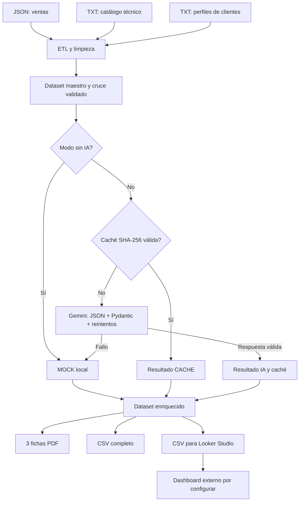

# TALSA | Transformación Digital: análisis técnico de ventas con IA

> **Prueba técnica · Practicante de Transformación Digital (Datos e IA)**  
> Python · pandas · Google Gemini · Pydantic · fpdf2 · Looker Studio

Este proyecto transforma **tres fuentes comerciales y técnicas sin claves comunes** en informes de compatibilidad para cada venta, fichas PDF con identidad visual TALSA y un CSV preparado para analizar en Looker Studio.

**En pocas palabras:** se lee lo que se vendió, se identifica la ficha del equipo, se recuperan las necesidades del cliente, se solicita o reutiliza un análisis técnico estructurado y se publican los resultados como archivos.

> [!IMPORTANT]
> Los datos del ejercicio son **ficticios**. El catálogo indica expresamente que algunas especificaciones están pendientes de validación con fábrica. Los resultados de IA, caché o simulación son **orientativos**, no sustituyen la validación de ingeniería, requisitos legales, manuales oficiales ni procedimientos de seguridad industrial.

## Índice

1. [Objetivo y alcance](#1-objetivo-y-alcance)
2. [Resultados esperados y estado de entrega](#2-resultados-esperados-y-estado-de-entrega)
3. [Tecnologías y requisitos previos](#3-tecnologías-y-requisitos-previos)
4. [Estructura del repositorio](#4-estructura-del-repositorio)
5. [Instalación desde cero](#5-instalación-desde-cero)
6. [Cómo ejecutar el pipeline](#6-cómo-ejecutar-el-pipeline)
7. [Flujo de datos y arquitectura](#7-flujo-de-datos-y-arquitectura)
8. [Cómo se cruzan datos sin claves foráneas](#8-cómo-se-cruzan-datos-sin-claves-foráneas)
9. [Cómo funciona el análisis con IA](#9-cómo-funciona-el-análisis-con-ia)
10. [Validaciones, reintentos y caché](#10-validaciones-reintentos-y-caché)
11. [Fichas PDF y manual de marca](#11-fichas-pdf-y-manual-de-marca)
12. [Dataset y dashboard de Looker Studio](#12-dataset-y-dashboard-de-looker-studio)
13. [Pruebas y verificación](#13-pruebas-y-verificación)
14. [Seguridad, límites y mejoras](#14-seguridad-límites-y-mejoras)
15. [Problemas frecuentes](#15-problemas-frecuentes)
16. [Información de entrega](#16-información-de-entrega)

## 1. Objetivo y alcance

El problema de negocio es que las ventas (`JSON`), las especificaciones técnicas (`TXT`) y las notas de visita de clientes (`TXT`) están separadas. Preparar una ficha adaptada a cada cliente requiere consultar manualmente distintas fuentes.

El pipeline automatiza cinco tareas:

1. **Ingesta y limpieza:** leer con Python y pandas; estandarizar textos, fechas, montos y unidades.
2. **Cruce:** asociar cada venta con su modelo de equipo y su perfil de cliente **sin claves compartidas de origen**.
3. **Enriquecimiento:** producir especificaciones, casos de uso, recomendaciones, compatibilidad (0–100) y complejidad (`Alto`, `Medio`, `Bajo`) con Gemini o, en modo local, con ejemplos simulados.
4. **Documentación:** generar **un PDF por venta**, tabulado y con los colores y el logotipo de TALSA.
5. **BI:** construir un dataset de **una fila por venta** para métricas, gráficos y filtros de Looker Studio.

Los tres equipos contemplados por los datos de la prueba son **PX-3000** (pasteurizador), **CV-150** (caldera) y **LF-50** (liofilizador).

## 2. Resultados esperados y estado de entrega

En `salida/` se incluyen los archivos generados:

| Archivo | Para qué sirve |
|---|---|
| `ficha_V-2026-0101.pdf` | Ficha de la venta del pasteurizador PX-3000. |
| `ficha_V-2026-0102.pdf` | Ficha de la venta de la caldera CV-150. |
| `ficha_V-2026-0103.pdf` | Ficha de la venta del liofilizador LF-50. |
| `dataset_looker_studio.csv` | Datos resumidos y tipados para el tablero de Looker Studio. |
| `ventas_analisis_completo.csv` | Exportación extendida para auditoría y trazabilidad. |
| `cache_ia.json` | Respuestas reutilizables cuya validez depende del hash de los insumos. |

**Comprobación del proyecto revisado:** 3 ventas, 3 PDFs de una página, 3 filas y 24 columnas en el CSV de Looker Studio; **14 pruebas de `pytest` aprobadas**. La ejecución local sin IA también se verificó de extremo a extremo.

**Estado del dashboard:** el código y el CSV están preparados para Looker Studio. El tablero interactivo publicado se encuentra disponible en: [Dashboard TALSA en Looker Studio](https://datastudio.google.com/reporting/4778f074-a166-4442-ae63-384c8d901691).

## 3. Tecnologías y requisitos previos

| Tecnología | Función |
|---|---|
| Python (recomendado 3.11 o superior) | Ejecución y organización del proceso. |
| `pandas` | Lectura, transformación, cruce y exportación tabular. |
| `google-genai` | Cliente oficial para Google Gemini. |
| `pydantic` | Validación de la estructura JSON devuelta por IA. |
| `fpdf2` | Diseño y creación de fichas PDF. |
| `python-dotenv` | Lectura local de variables de entorno desde `.env`. |
| `pytest` | Pruebas automatizadas. |
| Looker Studio | Visualización del CSV; se configura fuera del proyecto. |

Necesitas **Python** instalado, acceso a una terminal y, **solo para ejecutar Gemini en vivo**, conexión a Internet y una clave válida de Google AI Studio. No se requiere base de datos. No uses el entorno virtual de otra persona; créalo en tu computadora.

## 4. Estructura del repositorio

```text
talsa-transformacion-digital/
├── datos/
│   ├── clientes_ventas.json           # Datos comerciales de origen
│   ├── catalogo_equipos_raw.txt       # Fichas técnicas desordenadas
│   └── perfil_cliente_contexto.txt    # Necesidades operativas de clientes
├── modulos/
│   ├── etl.py                         # Extracción, limpieza, cruces y controles
│   ├── ia_cache.py                    # Prompt, Gemini, esquemas, reintentos y caché
│   ├── pdf_generator.py               # Renderizado de fichas corporativas
│   ├── bi_export.py                   # Dataset para BI, enlaces y ZIP seguro
│   └── __init__.py
├── recursos/
│   └── talsa-logo.png                 # Logo utilizado en los PDF
├── salida/
│   ├── ficha_V-2026-0101.pdf
│   ├── ficha_V-2026-0102.pdf
│   ├── ficha_V-2026-0103.pdf
│   ├── dataset_looker_studio.csv
│   ├── ventas_analisis_completo.csv
│   └── cache_ia.json
├── tests/
│   └── test_pipeline_ia.py
├── .env.example                       # Ejemplo sin claves reales
├── .gitignore                         # Exclusión de secretos y archivos locales
├── pipeline_ia.py                     # Único punto de entrada (CLI)
├── pytest.ini
├── requirements.txt
└── README.md
```

> `.env`, `.venv/`, `.git/`, las cachés de Python y los archivos temporales **no deben subirse ni incluirse en el ZIP de entrega**. `.env.example` sí debe incluirse.

## 5. Instalación desde cero

Abre una terminal **dentro de la carpeta raíz del proyecto**, donde se encuentra `pipeline_ia.py`.

### Windows PowerShell

```powershell
# 1. Comprobar Python
python --version

# 2. Crear y activar entorno virtual aislado
python -m venv .venv
.\.venv\Scripts\Activate.ps1

# 3. Instalar dependencias
python -m pip install -r requirements.txt

# 4. Crear archivo de configuración local (NO subirlo a Git)
Copy-Item .env.example .env
```

Si PowerShell restringe la activación, se puede usar directamente `\.venv\Scripts\python.exe pipeline_ia.py --sin-ia`, sin activar el entorno.

### macOS o Linux

```bash
python3 --version
python3 -m venv .venv
source .venv/bin/activate
python -m pip install -r requirements.txt
cp .env.example .env
```

**Configurar IA (opcional):** edita `.env` e introduce tu clave real, sin compartirla:

```dotenv
GEMINI_API_KEY="REEMPLAZAR_POR_MI_CLAVE_PRIVADA"
```

La API puede estar sujeta a disponibilidad, límites y costos del proveedor. Si solo quieres reproducir el ejercicio sin conectarte, **no hace falta una clave**: ejecuta `--sin-ia`.

## 6. Cómo ejecutar el pipeline

| Comando | Qué ocurre |
|---|---|
| `python pipeline_ia.py --sin-ia` | Ejecuta todo con resultados simulados, sin llamar a Gemini. Es la primera prueba recomendada. |
| `python pipeline_ia.py` | Intenta usar caché válida o consultar Gemini; si falla, usa un resultado `MOCK` y lo advierte. |
| `python pipeline_ia.py --modelo gemini-2.5-flash` | Solicita otro modelo; verifica previamente que exista y esté habilitado en tu cuenta. |
| `python pipeline_ia.py --sin-pdf` | Genera los CSV, sin regenerar fichas PDF. |
| `python pipeline_ia.py --salida-csv salida/mi_analisis.csv` | Cambia la ruta del CSV completo; con ruta personalizada no se genera automáticamente el CSV de Looker salvo configuración adicional por código. |
| `python pipeline_ia.py --url-base-pdf "https://mi-dominio.example/fichas"` | Genera el campo de PDF con enlaces públicos **solo si tú ya publicaste esos PDF en esa ubicación**. |
| `python pipeline_ia.py --help` | Lista argumentos y valores predeterminados. |

Para una demostración controlada, empieza con:

```powershell
python pipeline_ia.py --sin-ia
```

Busca el resumen final en consola y abre `salida/`. En un modo `MOCK`, tanto el PDF como los CSV indican claramente que el resultado **no** procede de una consulta en vivo a Gemini.

**Para mostrar una petición nueva a Gemini:** configura la clave, respalda `salida/cache_ia.json`, elimina **solo** esa caché de tu copia local o modifica deliberadamente los insumos/modelo y ejecuta `python pipeline_ia.py`. Comprueba en la consola `Origen: IA`. Si ves `CACHE`, se reutilizó una respuesta; si ves `MOCK`, no hubo respuesta válida de Gemini.

## 7. Flujo de datos y arquitectura



La **orquestación** está en `pipeline_ia.py`. Los módulos encapsulan funciones especializadas y se comunican mediante `DataFrame` y esquemas Pydantic. Esto facilita ejecutar y probar ETL, IA, PDF y BI de manera independiente.

## 8. Cómo se cruzan datos sin claves foráneas

### Venta + equipo: clave de modelo normalizada

El nombre comercial y la ficha técnica incluyen un identificador alfanumérico, aunque escrito de maneras diferentes:

| Fuente comercial | Fuente técnica | Clave interna |
|---|---|---|
| `Pasteurizador de placas PX-3000` | `px3000` | `PX3000` |
| `Caldera pirotubular CV-150` | `CV150` | `CV150` |
| `Liofilizador industrial LF-50` | `LF 50` | `LF50` |

`extraer_codigo_modelo()` utiliza una expresión regular que reconoce **dos letras y de dos a cuatro números**, admite espacios o guiones y devuelve un código estándar en mayúsculas. Se realiza un `LEFT JOIN` por `codigo_modelo` y se **rechazan ventas sin ficha asociada**.

### Venta + cliente: nombre de empresa normalizado

`cargar_perfiles_clientes()` separa las notas comerciales por párrafos; cada bloque comienza con la razón social seguida por un guion. Se genera `empresa_norm` pasando el nombre a minúsculas y quitando espacios de borde. El sistema hace un `LEFT JOIN` con `empresa_norm` derivado de las ventas y **rechaza clientes sin perfil**.

**¿Por qué no usar `id_cliente`?** Porque ese identificador está en el JSON de ventas, pero no en el archivo de notas. Normalizar un dato presente en ambas fuentes permite cruzar la información sin inventar claves.

### Otras transformaciones y controles

- `pd.json_normalize()` convierte `ubicacion.ciudad`, `ubicacion.departamento` y `ubicacion.pais` en columnas.
- Las fechas se convierten a `YYYY-MM-DD`; los montos a números con dos decimales.
- Las unidades se homogeneizan, por ejemplo `72°C` → `72 °C`, `15 seg` → `15 s`, `440V` → `440 V`, `2000 l/h` → `2000 L/h`.
- Se comprueban: campos obligatorios, valores vacíos, `id_venta` duplicados, fechas inválidas, montos menores o iguales a cero y modelos desconocidos.

**Limitación:** el emparejamiento por nombre puede fallar ante tildes, variaciones de razón social, errores ortográficos o nombres repetidos. El método actual es adecuado para estas tres entradas controladas; para producción convendría una tabla de correspondencias aprobada y revisión manual de casos ambiguos.

## 9. Cómo funciona el análisis con IA

### Datos enviados y diseño del prompt

`construir_prompt()` genera una instrucción por venta con cuatro secciones: (1) rol de ingeniero de aplicaciones TALSA, (2) reglas de fundamentación y límites, (3) ficha técnica del equipo y (4) contexto real del cliente. Se pide **comparar** capacidad, caudal, presión, temperatura, energía, agua de servicio y exigencias regulatorias **solo cuando los datos lo permiten**.

El prompt exige:

- Extraer especificaciones técnicas cuantificables.
- Proponer **casos de uso concretos** para esa planta.
- Recomendar un **parámetro**, su **valor y unidad** y un **motivo** apoyado en las fuentes.
- Asignar un `score_compatibilidad` entero entre **0 y 100** y una `complejidad_tecnica` de `Alto`, `Medio` o `Bajo`.
- Penalizar problemas de infraestructura; **no inventar parámetros ausentes**.

### Salida JSON estructurada

Gemini se invoca con `response_mime_type="application/json"`, un `response_schema` Pydantic y temperatura de `0.1`. Un ejemplo **ilustrativo, no el resultado real de una venta**, es:

```json
{
  "especificaciones_tabla": [
    {"parametro": "Capacidad nominal", "valor": "3.000 L/h"},
    {"parametro": "Temperatura", "valor": "72 a 85 °C"}
  ],
  "casos_uso": [
    "Pasteurización continua de leche",
    "Mejora del rendimiento frente al proceso por lotes"
  ],
  "recomendaciones": [
    {"parametro": "Agua helada", "valor_unidad": "2 °C", "motivo": "Temperatura requerida por la ficha para el enfriamiento final"},
    {"parametro": "Caudal nominal", "valor_unidad": "3.000 L/h", "motivo": "Referencia del catálogo para leche entera"},
    {"parametro": "Presión máxima", "valor_unidad": "6 bar", "motivo": "Límite técnico indicado en la ficha"}
  ],
  "score_compatibilidad": 80,
  "justificacion_score": "El equipo es compatible con el proceso continuo, sujeto a mejorar el suministro de agua helada.",
  "complejidad_tecnica": "Medio"
}
```

En la práctica, el esquema admite **2–8 especificaciones**, **2–4 casos** y **3–5 recomendaciones**. `AnalisisTecnicoIA` incorpora además `origen_analisis`, que no forma parte del esquema enviado al modelo.

> El score **lo estima el modelo**, no es una fórmula ingenieril certificada ni una probabilidad. La complejidad también es una categoría de evaluación asistida por IA.

## 10. Validaciones, reintentos y caché

### Respuestas inválidas y fallos de API

`ejecutar_con_backoff()` intenta la llamada hasta **3 veces** de forma predeterminada y valida el texto JSON y el esquema **dentro del bucle de reintentos**. Usa esperas progresivas con variación aleatoria (*jitter*) para errores transitorios, entre ellos `429`, `503` y timeouts, y también reintenta JSON malformado y errores de esquema. Ante fallo definitivo, se registra el problema y se usa **MOCK**.

Los modelos Pydantic validan tipos, número de elementos, límites del score y valores posibles de complejidad. `verificar_respaldo_contenido()` añade una **comprobación heurística** de coincidencias léxicas y cifras contra las fuentes. El resultado se exporta en `contenido_verificado`.

**Precisión importante:** `contenido_verificado=true` significa que pasó esa heurística, **no que se haya probado matemáticamente cada afirmación ni que una persona la haya aprobado**. El sistema advierte sobre falta de respaldo, pero actualmente no bloquea automáticamente todas esas respuestas.

### Trazabilidad del origen

| Valor | Significado | ¿Se consulta Gemini en esta ejecución? |
|---|---|---|
| `IA` | Respuesta nueva validada del modelo. | Sí. |
| `CACHE` | Respuesta previa asociada a los mismos insumos. | No. |
| `MOCK` | Simulación local predefinida o contingencia. | No, o la consulta falló. |

### Cómo evita repetir consultas

Se calcula un hash SHA-256 del **modelo, el prompt, la ficha y el perfil del cliente**. La entrada en `salida/cache_ia.json` se reutiliza únicamente si el hash coincide y la estructura pasa Pydantic. Si cambias alguno de esos elementos, el hash deja de coincidir y, sin `--sin-ia`, se intenta una nueva consulta. Las respuestas `MOCK` **no se guardan como si fueran IA**.

La caché puede contener análisis desactualizados respecto a normas o condiciones reales si sus textos fuente no se actualizan. No equivale a una revisión de vigencia técnica.

## 11. Fichas PDF y manual de marca

`modulos/pdf_generator.py` usa `fpdf2`, tamaño A4, secciones numeradas y tablas con información comercial, contexto del cliente, especificaciones, casos de uso y recomendaciones. Genera un archivo con nombre `ficha_<id_venta>.pdf` por cada venta.

Se respetan las siguientes reglas del **Manual de Marca TALSA**:

| Elemento | Aplicación |
|---|---|
| Logotipo | Arriba a la izquierda, proporción original, sobre fondo claro; altura aproximada de 2 cm. |
| Rojo principal `#DC182A` | Títulos, líneas divisorias y encabezados de tabla. |
| Gris claro `#F4F4F4` | Filas alternas en las tablas. |
| Negro y blanco | Texto principal y fondos. |
| Gris `#808080` | Pie de página y contenidos secundarios. |
| Lema | «¡Siempre a tu lado para apalancar tu éxito!». |
| Pie | Nombre de TALSA y número de página. |
| Fuente | Helvetica, alternativa permitida por el manual a Bebas Neue y Kanit. |

Cada ficha incorpora score, complejidad y el **origen del análisis**. Los PDFs de `MOCK` muestran una advertencia adicional. Los archivos de muestra incluidos tienen una página cada uno; los documentos más extensos pueden paginarse automáticamente.

**Nota:** el código reemplaza algunos caracteres fuera de Latin-1 para que Helvetica los imprima sin problemas. Si se necesita máxima fidelidad tipográfica, una mejora sería incrustar una fuente Unicode autorizada.

## 12. Dataset y dashboard de Looker Studio

> **Dashboard publicado:** [Dashboard TALSA en Looker Studio](https://datastudio.google.com/reporting/4778f074-a166-4442-ae63-384c8d901691)

### Archivos: diferencias

`salida/ventas_analisis_completo.csv` conserva campos de auditoría y resúmenes detallados. `salida/dataset_looker_studio.csv` está **optimizado para BI**: elimina objetos de Python, JSON anidados y textos técnicos crudos; deja dimensiones, métricas, ruta del PDF y resúmenes en una línea.

### Diccionario de datos del CSV BI

| Campo(s) | Tipo recomendado en Looker Studio | Interpretación |
|---|---|---|
| `id_venta`, `id_cliente` | Texto | Identificadores de venta y cliente. |
| `fecha_venta` | Fecha | Fecha comercial en formato `YYYY-MM-DD`. |
| `empresa`, `industria` | Texto | Cliente e industria para segmentación. |
| `ciudad`, `departamento`, `pais` | Texto / geográfico cuando corresponda | Ubicación del cliente. |
| `equipo_comprado`, `tipo_equipo`, `codigo_modelo` | Texto | Descripción, familia y modelo del equipo. |
| `complejidad_tecnica` | Texto | Clasificación `Alto`, `Medio`, `Bajo`. |
| `origen_analisis` | Texto | `IA`, `CACHE` o `MOCK`; útil para filtrar simulaciones. |
| `contenido_verificado` | Booleano | Resultado de la comprobación heurística de respaldo. |
| `monto_usd` | Número / Moneda USD | Valor comercial de la venta. |
| `score_compatibilidad` | Número | Score 0–100 de compatibilidad estimada. |
| `num_casos_uso`, `num_recomendaciones`, `num_especificaciones` | Número entero | Cantidad de elementos de cada análisis. |
| `archivo_ficha_pdf` | Texto / URL (si es público) | Ruta relativa o URL publicada de la ficha. |
| `justificacion_score` | Texto | Explicación de la puntuación. |
| `resumen_casos_uso`, `resumen_recomendaciones`, `resumen_especificaciones` | Texto | Descripciones sintetizadas para tablas. |

**Granularidad:** una fila representa una venta individual, no una recomendación ni un cliente. Para evitar duplicación de montos, no explotes las recomendaciones en filas del mismo dataset sin ajustar las métricas.

### Cómo construir el dashboard (paso a paso)

1. Abre **Looker Studio** con una cuenta con permiso para crear informes y selecciona **Crear → Informe**.
2. Conecta el archivo `salida/dataset_looker_studio.csv`. Si la interfaz no admite cargarlo directamente, súbelo primero a Google Sheets y conecta esa hoja como fuente. **No cambies los encabezados**.
3. Comprueba los tipos de campos: `fecha_venta` como fecha, `monto_usd` y `score_compatibilidad` como numéricos; `complejidad_tecnica`, `tipo_equipo` e `industria` como dimensiones de texto.
4. Crea dos **tarjetas de KPI**: `SUM(monto_usd)` y `AVG(score_compatibilidad)`; no uses suma para calcular el promedio de compatibilidad.
5. Crea un gráfico de barras de **ventas por industria**: dimensión `industria`, métrica `SUM(monto_usd)`.
6. Crea un gráfico de barras apiladas o tabla dinámica para **distribución de complejidad por tipo de equipo**: dimensión `tipo_equipo`, desglose `complejidad_tecnica`, métrica `COUNT_DISTINCT(id_venta)` o recuento de registros, evitando sumar el score.
7. Añade **controles de filtro** por `industria`, `tipo_equipo` y un control de intervalo para `fecha_venta`.
8. Agrega una tabla detallada con empresa, equipo, monto, score, complejidad, origen y, si son URLs públicas, enlaces a las fichas.
9. Prueba que los filtros afecten los gráficos y KPIs; revisa la legibilidad de títulos, moneda USD, unidades y colores.
10. Comparte el informe con **permiso de lectura** para el evaluador y copia el vínculo en [Información de entrega](#17-información-de-entrega).

**Valores de comprobación del CSV incluido:** 3 ventas, `SUM(monto_usd) = USD 256.700,00` y `AVG(score_compatibilidad) = 85`. Estos números describen **el CSV adjunto**, no una cifra fija: pueden cambiar al regenerar análisis con otro modelo o en modo `MOCK`.

### Enlazar fichas desde Looker Studio

Por defecto, `archivo_ficha_pdf` contiene una **ruta local** como `salida/ficha_V-2026-0101.pdf`. **Una ruta local no es una URL accesible desde Internet**. Para que un lector del dashboard pueda abrir el PDF:

1. Publica cada archivo en una ubicación autorizada que permita acceso de lectura a los evaluadores.
2. Si todos los PDF comparten un mismo directorio y nombre de archivo, configura `TALSA_PDF_BASE_URL` o `--url-base-pdf` con su **URL real**.
3. Si cada PDF tiene una URL distinta, define `TALSA_PDF_LINKS_MAP` en `.env`, apuntando a un JSON de correspondencias, por ejemplo:

```json
{
  "V-2026-0101": "https://ejemplo.invalid/fichas/ficha_V-2026-0101.pdf"
}
```

4. Regenera el CSV y verifica el acceso desde una sesión que no sea la tuya. El dominio `.invalid` del ejemplo **no es una publicación real**.

## 13. Pruebas y verificación

Desde la raíz del repositorio, con las dependencias instaladas:

```powershell
python -m pytest -v
```

La suite en `tests/test_pipeline_ia.py` tiene **14 tests** que comprueban extracción de modelo, tipos de equipo, esquema Pydantic, cruce ETL, errores 429/503/timeout, JSON inválido, invalidación de caché, ausencia de contaminación `MOCK`, normalización de unidades, validación de ventas, respaldo de contenido, exportación CSV, generación de PDF y un flujo de extremo a extremo que incluye ZIP seguro.

**Resultado de la revisión realizada el 22/10/2026:** `14 passed`. También se ejecutó `python pipeline_ia.py --sin-ia` de forma aislada, con los tres PDF y ambos CSV generados. La prueba **no certifica** una llamada real a la API de Gemini ni la existencia de un informe publicado en Looker Studio: esas partes requieren verificación con credenciales y enlaces externos.

### Lista rápida para comprobar una entrega

- [x] El proceso ETL lee los tres archivos de entrada y encuentra sus tres cruces.
- [x] El análisis tiene JSON estructurado, validaciones, reintentos, caché y modo simulado.
- [x] Se generan automáticamente las tres fichas PDF con el diseño TALSA.
- [x] Se genera un CSV de una fila por venta con métricas y dimensiones.
- [x] Hay pruebas automáticas y origen de cada análisis.
- [x] `README.md`, `requirements.txt`, `.env.example` y `.gitignore` disponibles.
- [x] Publicar el dashboard y entregar su URL con acceso de lectura (paso externo pendiente).

## 14. Seguridad, límites y mejoras

### Seguridad

- **Nunca subas `.env` al repositorio ni lo adjuntes a un ZIP**. `.gitignore` evita el seguimiento accidental por Git, **pero no elimina secretos de un ZIP creado manualmente**.
- Si una clave se publicó o compartió accidentalmente, **revócala y genera una nueva** desde su proveedor. Borrarla de una copia no anula la clave ya expuesta.
- Usa `.env.example` solo como plantilla, sin secretos. Revisa también archivos históricos y commits antes de publicar un repositorio.
- Revisa los permisos de los PDF en la nube antes de enlazarlos desde un dashboard.
- Antes de entregar, instala dependencias desde `requirements.txt`; **no distribuyas tu carpeta `.venv/`**, porque depende del sistema operativo y aumenta mucho el tamaño.

### Limitaciones conocidas

- El parseo de textos se apoya en delimitadores y expresiones regulares propios de **estas fuentes de muestra**; no es un extractor universal de PDF, OCR ni documentos de fabricantes.
- Los nombres de empresas se comparan tras pasar a minúsculas y recortar espacios; no hay conciliación difusa ni tabla de equivalencias.
- La verificación de contenido es heurística: una coincidencia de números o términos **no garantiza** que las conclusiones sean correctas o seguras.
- Los scores, casos de uso y complejidad son estimaciones de IA (o ejemplos `MOCK`), no cálculos deterministas auditados.
- En una caída de API o ausencia de credenciales, el programa **puede terminar con archivos `MOCK`**. Por eso siempre se debe revisar `origen_analisis`; una ejecución terminada no demuestra inferencia real.
- Las versiones de `requirements.txt` definen mínimos (`>=`), no un bloqueo exacto de dependencias; una versión futura puede cambiar el comportamiento.
- La publicación del dashboard, el alojamiento de PDFs y la validación por especialistas **no están automatizados**.

### Qué mejoraría con más tiempo (priorizado)

1. **Alta prioridad:** validación humana de recomendaciones críticas y matriz explícita *afirmación → fragmento de fuente → unidad*, con rechazo de recomendaciones sin evidencia.
2. **Alta prioridad:** control estricto de estado: fallar con código de salida distinto de cero cuando se exige IA real y esta no está disponible, en vez de aceptar silenciosamente `MOCK` como resultado final.
3. **Alta prioridad:** pruebas de integración reales en entorno autorizado para Gemini y validación de que el enlace a Looker Studio funciona con permisos de lectura.
4. **Prioridad media:** esquema de identificadores maestro y reconciliación de nombres/modelos ambiguos; validación de unicidad de perfiles.
5. **Prioridad media:** reglas transparentes y calibración de `score_compatibilidad` y `complejidad_tecnica` con expertos y rúbrica de puntuación reproducible.
6. **Prioridad media:** bloqueo de dependencias, integración continua, métricas de costo/latencia y manejo de límites de API.
7. **Evolución futura:** almacenamiento central de datos y publicación controlada de PDFs, conectados automáticamente al dashboard.

## 15. Problemas frecuentes

| Síntoma | Causa probable | Solución |
|---|---|---|
| `ModuleNotFoundError: No module named 'google'` | Dependencias no instaladas en el entorno activo. | Activa `.venv` e instala `python -m pip install -r requirements.txt`. |
| `No se encontró GEMINI_API_KEY` o salida `MOCK` | Clave ausente, inválida, límite de cuota o fallo API. | Revisa `.env`, acceso y logs; utiliza `--sin-ia` si solo quieres probar localmente. |
| Siempre aparece `CACHE` en lugar de `IA` | El hash del análisis existente coincide con los insumos. | Respalda y retira `salida/cache_ia.json` en tu copia y ejecuta con clave configurada. |
| Los enlaces del PDF no abren en Looker Studio | Son rutas `salida/...` que solo existen localmente. | Publica los PDFs con permisos adecuados, establece URL base/mapa y regenera CSV. |
| `FileNotFoundError` o fallo de cruce | Archivos de datos faltantes, formato modificado o modelo/empresa no reconocidos. | Conserva los tres nombres de archivo y revisa los datos originales y el mensaje ETL. |
| Excel interpreta mal tildes o caracteres | Codificación del archivo. | Importa el CSV como **UTF-8** (`utf-8-sig` al exportar). |
| PowerShell no permite activar `.venv` | Restricción de ejecución de scripts. | Ejecuta `\.venv\Scripts\python.exe` directamente. |
| El sistema dice «éxito», pero necesito inferencia real | El programa hizo contingencia local. | Inspecciona `origen_analisis`; exige `IA` para una prueba de llamada nueva. |

## 16. Información de entrega

| Elemento | Estado / enlace |
|---|---|
| Repositorio GitHub o GitLab | [Repositorio Talsa](https://github.com/aluminetor/talsa-transformacion-digital) |
| Dashboard Looker Studio | [Dashboard TALSA en Looker Studio](https://datastudio.google.com/reporting/4778f074-a166-4442-ae63-384c8d901691) |
| Archivos de salida | Carpeta [`salida/`](salida/) de este repositorio. |
| Ejecución | `python pipeline_ia.py` o `python pipeline_ia.py --sin-ia`. |
| Pruebas | `python -m pytest -v`. |
| Datos y material | Fuentes ficticias proporcionadas para la prueba técnica TALSA. |
| Licencia del proyecto | **No declarada**; no se presupone permiso general de redistribución. |

---

